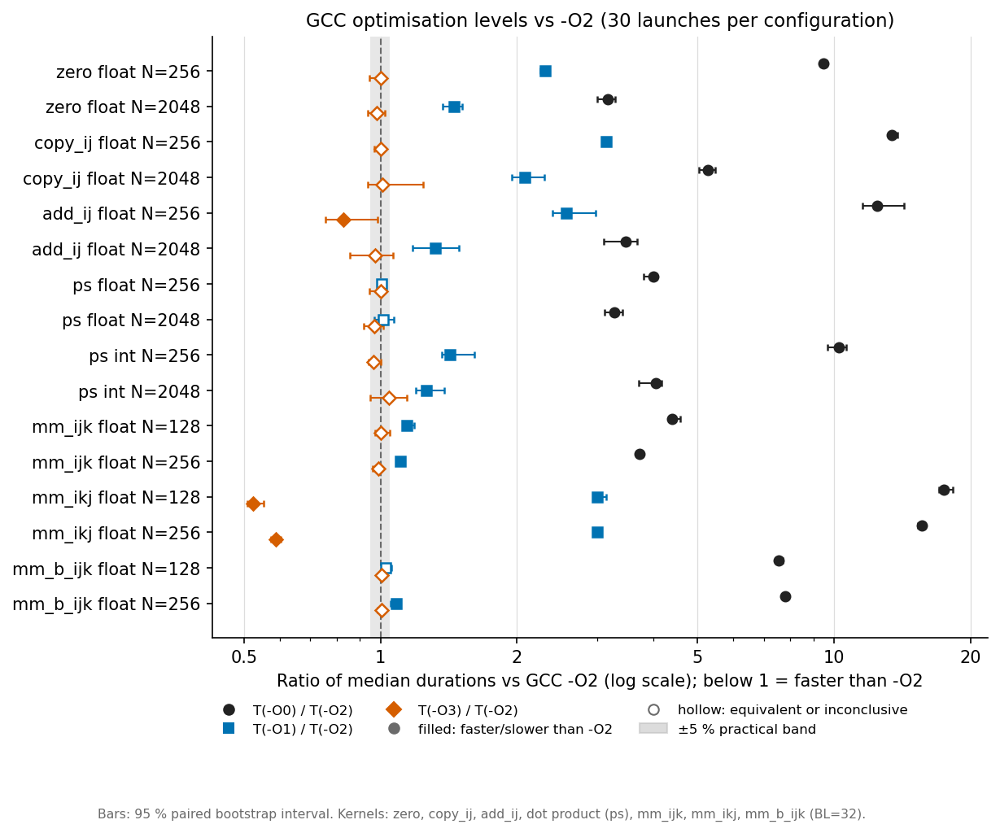
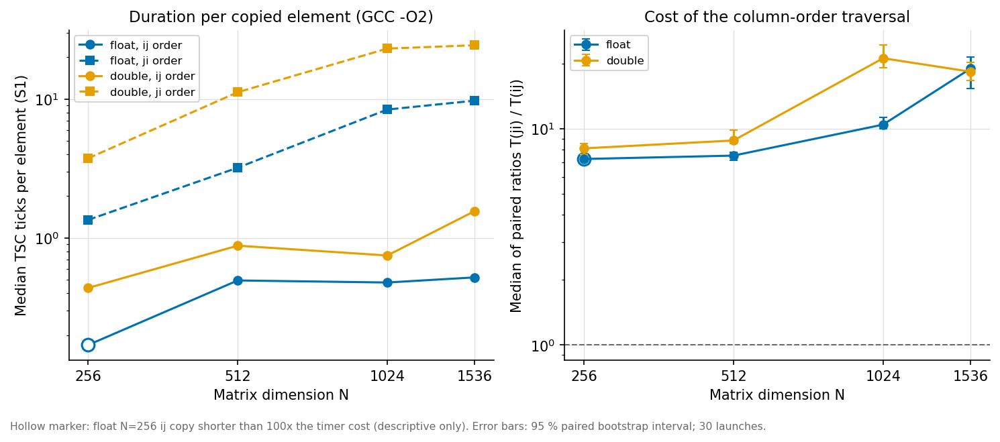
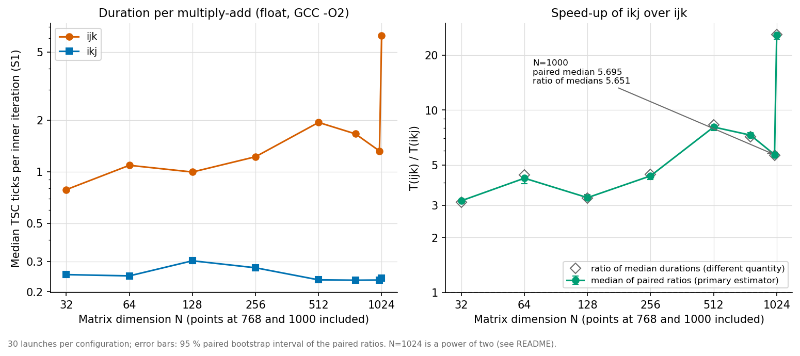
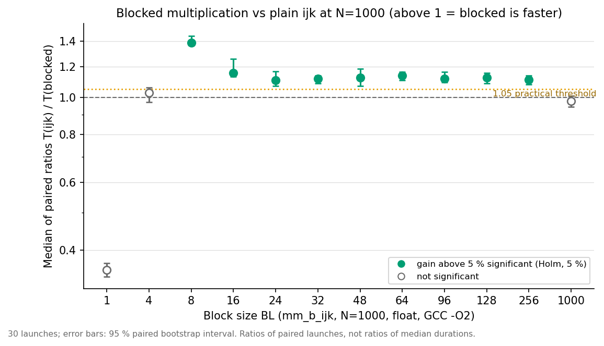
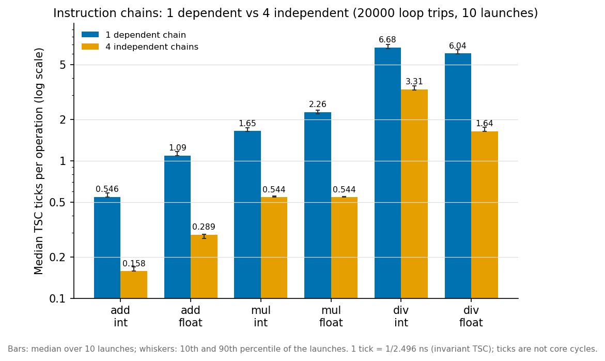

# CPU Architecture and Performance Analysis

C programs and measurements on how loop order, compiler options, blocking, and
independent accumulators change the execution time of simple kernels on an
x86-64 processor. Timing uses the Time Stamp Counter (`RDTSCP` with fences).

*En bref.* Programmes C et mesures sur l'influence de l'ordre des boucles, des options d'optimisation de GCC, du découpage par blocs et des accumulateurs indépendants sur le temps d'exécution de noyaux simples, sur un processeur x86-64. Le temps est mesuré avec le compteur d'horodatage (TSC, `RDTSCP` avec barrières) ; l'unité est le tick TSC, pas le cycle du cœur. Les résultats sont des mesures relatives obtenues sur une seule machine ; leurs limites sont décrites plus bas. La documentation est rédigée en anglais.

**Author:** Mehdi BOUAMA, Master 2 SETI (Systèmes Embarqués et Traitement de
l'Information), Université Paris-Saclay, 2026. Course project in processor
architecture.

## Technical objectives

- Measure execution time with a TSC-based timer and state exactly what the
  numbers mean (ticks, not core cycles).
- Quantify the effect of GCC optimisation levels `-O0` to `-O3`.
- Compare memory access orders: row-wise vs column-wise copy, `ijk` vs `ikj`
  matrix multiplication.
- Study blocking (tiling) of the matrix product and the choice of block size.
- Compare a single-accumulator dot product with a four-accumulator version.
- Check every kernel against independent `long double` oracles, including under
  AddressSanitizer and UndefinedBehaviorSanitizer.

## Reference platform

| Item | Value |
| --- | --- |
| Processor | Intel Core i5-1335U (hybrid), one performance core used for the reference results |
| TSC | invariant, 2.496 GHz (CPUID leaf 0x15) |
| Caches | L1D 48 KiB, L2 1.25 MiB per performance core, L3 12 MiB |
| Compiler | GCC 13.3.0 (Ubuntu 24.04), `-std=gnu11`, `-O0` to `-O3` as stated, no `-march`, no `-ffast-math` |
| Environment | Linux; frequency, temperature, and background load not controlled |

## Algorithms implemented

| Program | Kernels |
| --- | --- |
| `tp1` | `zero`; matrix copy `copy_ij`, `copy_ji`; matrix addition `add_ij`, `add_ji`; dot product `ps`; matrix multiplication `mm_ijk`, `mm_ikj`; blocked multiplication `mm_b_ijk` (block size `BL`) |
| `matrix_extras` | `transpose`; transposed product `trans_mul`, `trans_total`; four-accumulator dot product `ps4`; `mm_ijk`, `mm_ikj`, `mm_b_ijk`, `ps` with an analytic correctness oracle |
| `latency` | x86 assembly chains: add, multiply, divide, empty loop, for integer and float, one or four independent chains |
| `tsc_probe`, `overhead_probe`, `cpu_probe` | TSC cross-check and empty-timer cost, instrumentation overhead scaling, CPUID and cache description (one JSON line) |

The basic kernels of `tp1.c` derive from the skeleton provided with the
course. The timing header `tsc.h`, the instrumentation, the matrix extras,
the probes, and the tests are the author's work.

## Results

Reference results measured on the platform above; the tables are in
[`results/csv`](results/csv), the definitions and conditions in
[`results/README.md`](results/README.md). These are archived results from
a longer protocol than `make run` (30 launches, pinned core, random
order); `make` does not regenerate them. A ratio `a / b` is above 1 when `b`
is faster.

| Question | Result |
| --- | --- |
| GCC `-O0` vs `-O2` | slower in all 16 configurations: ratio 3.2 to 17.5 |
| GCC `-O1` vs `-O2` | slower in 13 of 16 (1.08 to 3.14), equivalent for one, inconclusive for two |
| GCC `-O3` vs `-O2` | faster for `mm_ikj` (0.52 at N=128, 0.59 at N=256) and `add_ij` at N=256 (0.83); equivalent or inconclusive for the others |
| Copy, column-wise (`ji`) vs row-wise (`ij`) | `ji` slower: median of paired ratios from 7.2 (float, N=256; descriptive only, the call is shorter than 100 times the timer cost) to 21.2 (double, N=1024) |
| `mm_ijk` vs `mm_ikj`, N=1000 | `ikj` faster: **median of paired ratios 5.695** (95 % interval 5.552 to 5.862) |
| Same, as a ratio of median durations | 5.651 (a different quantity: 1.3226 vs 0.2340 ticks per iteration, 0.530 s vs 0.094 s per product) |
| `mm_ijk` vs `mm_ikj`, N=1024 | median of paired ratios 25.8 (24.5 to 26.8); `ijk` costs 6.23 ticks per iteration at N=1024 and 1.32 at N=1000 |
| Block size, N=1000, vs `mm_ijk` | `BL=8`, the smallest tested block size meeting the criterion in [`results/README.md`](results/README.md) (median of paired ratios 1.388, 1.365 to 1.446); `BL=32` 1.119 (1.088 to 1.138); `BL=1` 0.355; `BL=1000` 0.976, not significant |
| `ps4` vs `ps`, float | gain 3.93 at N=256, 2.59 at N=512, 1.75 at N=1000 (1.38 to 2.00) |

The median of paired ratios is the primary estimator of a gain; the ratio of
median durations is published beside it and is a different quantity.









The difference between N=1000 and N=1024 is compatible with row strides that
are a power of two (4096 bytes) conflicting in the cache sets; this was not
verified with hardware counters. Likewise the large `ji` penalty is compatible
with a column-wise stride, not demonstrated as a cause.

## Additional reference tables

These tables complement the results above. They come from the same measurement campaigns and are described in [`results/README.md`](results/README.md). Values are ticks of the invariant TSC, not core cycles.

- [`instruction_latency.csv`](results/csv/instruction_latency.csv): add, multiply and divide chains, one dependent chain against four independent chains, 10 launches. At 20000 loop trips the median is 0.546 tick per integer add on one chain and 0.158 on four (float: 1.091 and 0.289); a division costs 6.68 (integer) and 6.04 (float) ticks on one chain, 3.31 and 1.64 on four. Ticks are TSC ticks, not core cycles; the empty-loop controls are listed in the table.

  
- [`transposed_product.csv`](results/csv/transposed_product.csv): the three product kernels against the total cost of transposing and multiplying (`trans_total`), N = 256 and 1000, float and int. A ratio above 1 means the kernel is slower. `mm_ikj` is faster than `trans_total` (0.218 for float, N=1000) and `mm_ijk` slower (1.25 for float and 10.3 for int, N=1000). The float and int results differ; no cause is established.
- [`transpose_amortization.csv`](results/csv/transpose_amortization.csv): a simple model of the number of reuses needed to amortise one transposition. For `mm_ijk` and `mm_b_ijk` the threshold is below 0.1 in every row, so the model predicts a benefit from the first use; for `mm_ikj` there is no threshold, because the transposed product is not faster than `mm_ikj`. The values are estimated from medians.
- [`addition_order_ij_vs_ji.csv`](results/csv/addition_order_ij_vs_ji.csv): matrix addition, row-wise against column-wise, GCC `-O3`. Two of the eight rows show a difference: float N=256 (`ji` slower, median of paired ratios 1.29, interval 1.09 to 1.42) and double N=256 (`ji` faster, 0.858, interval 0.824 to 0.903). The other six are inconclusive. The ratio of median durations and the median of paired ratios can differ (float N=512: 1.25 against 0.99).

## Timing methodology

- Each measurement is `MFENCE; RDTSCP; LFENCE` before and after the kernel,
  with a compiler `memory` clobber. MFENCE drains earlier stores, RDTSCP waits
  for earlier execution and loads, LFENCE stops later instructions from
  crossing the timestamp.
- The unit is the TSC tick. The TSC of the reference platform is invariant, so
  it counts at a constant 2.496 GHz regardless of the core frequency; it is
  not a core cycle counter, and turbo, frequency scaling, and hybrid cores
  prevent a direct conversion to cycles. Seconds are `ticks / 2.496e9`.
- The `IA32_TSC_AUX` tag is recorded at both ends of each sample; samples with
  different tags (migration) are marked invalid but kept in the raw output.
- Initialisation, printing, and the checksum are outside the timed interval.
  Repetitions reuse buffers, so data may be warm in cache after the first.
- An empty timer pair costs roughly 50 to 140 ticks depending on the
  campaign and the optimisation level; the reference results require calls at
  least 100 times longer than that cost (one documented exception).

Details and statistics: [`docs/METHODOLOGY.md`](docs/METHODOLOGY.md).

## Limits of the measurements

- Single machine, hybrid processor, uncontrolled frequency and temperature
  (package temperature 70 to 100 C during the campaigns). Absolute values do
  not transfer; orderings are the result.
- No hardware performance counters were available, so cache and memory
  explanations remain hypotheses.
- Intervals are descriptive; rounds were not shown to be independent and the
  GCC table involves many comparisons without multiplicity correction.
- The reference results were produced with a longer protocol than the one the
  public programs implement (see [`results/README.md`](results/README.md) and
  section 7 of the methodology).
- `matrix_extras` requires a 4-byte `TYPE` (`float` or `int`).
- Measurements are for relative comparison on one host, not absolute
  performance claims.

## Requirements

x86-64 Linux with SSE2 and `RDTSCP`, GCC (default; `CC=clang` also builds and
passes the tests), GNU Make, `nm` (for the sanitizer check), `-lm`.

## Build, run, and test

```sh
make                  # build the programs (N=1000, TYPE=float, BL=32, M=16)
make test             # 66 functional checks, a few seconds
make test-sanitize    # same checks with ASan and UBSan, separate build
make check            # tests plus a smoke run of every program, about 15 s
make bench            # quick tp1 run: N=32, BL=8, M=4
make bench-full       # tp1 run: N=1000, BL=32, M=16 (duration depends on the hardware and conditions)
make run N=256 M=5    # tp1 with chosen parameters (N, TYPE, BL, M)
make clean
```

Build products go to `build/N<N>_<TYPE>_B<BL>_M<M>_<checksum>/bin`, a
directory selected by the compiler, the flags, and the four parameters, so a
changed parameter never reuses an old executable. The Makefile defaults are
`N=1000`, `TYPE=float`, `BL=32`, `M=16`; compiling `src/tp1.c` directly
without the Makefile uses the source defaults `N=1000`, `TYPE=float`,
`BL=16`, `M=16`. `make print-bin-dir` prints the directory of the current
configuration. To run a program directly, pinned to core 0:

```sh
make
BIN=$(make print-bin-dir)
taskset -c 0 "$BIN/tp1" mm_ikj
taskset -c 0 "$BIN/cpu_probe"      # check the core type and the invariant TSC
```

Each run prints a header, a CSV block of raw samples (`function,sample,ticks,
denominator,ticks_per_iteration,aux_start,aux_stop,valid`), and a checksum.

## Tests

The tests build 12 variants (float, int, double; N=32 and N=33) of
`tests/test_tp1.c` and `tests/test_matrix.c` and compare every kernel with
independent `long double` oracles, repeated calls, input preservation, and
transposition. Dimensions that are not multiples of the block size are
covered. `make test-sanitize` builds in `build/sanitize`, verifies that each
executable links the ASan and UBSan runtimes, and aborts on any report
(`-fno-sanitize-recover=all`). Each test prints one or more `PASS` lines on
stderr; any `FAIL` or a non-zero exit stops the run.

## Project structure

```
src/        C programs and the TSC timer (tsc.h)
tests/      functional tests
docs/       timing methodology
results/    reference CSV tables and figures, data dictionary
Makefile    build, test, and run targets
```

## License

MIT. See [LICENSE](LICENSE).
