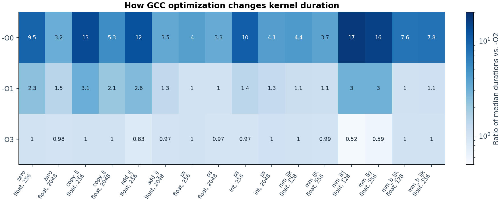
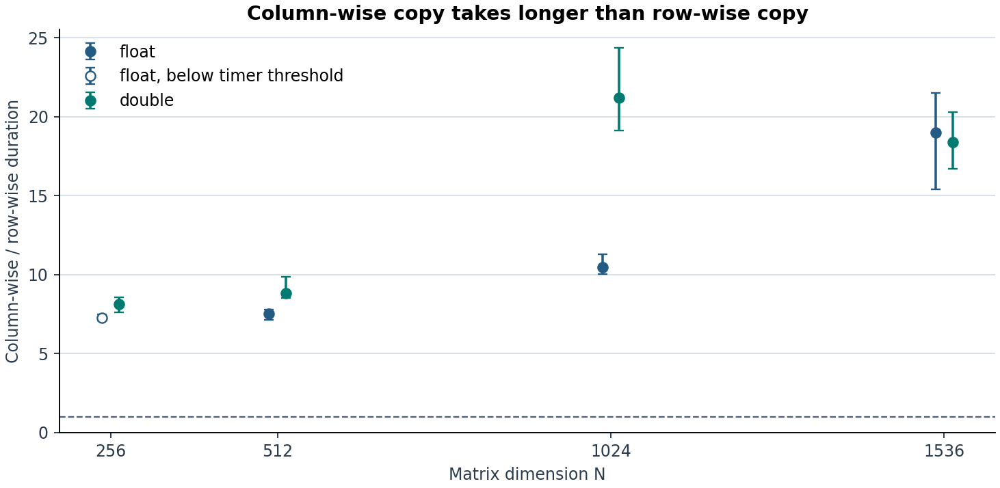
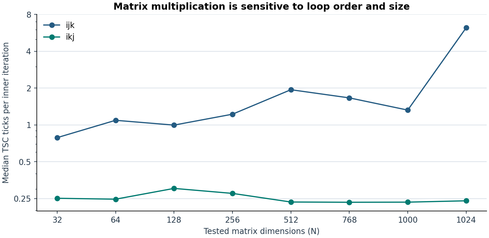
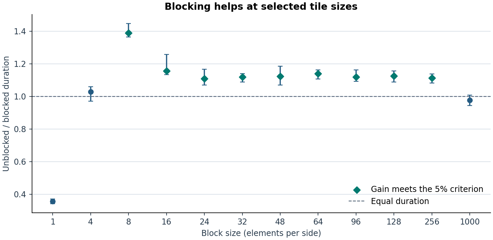
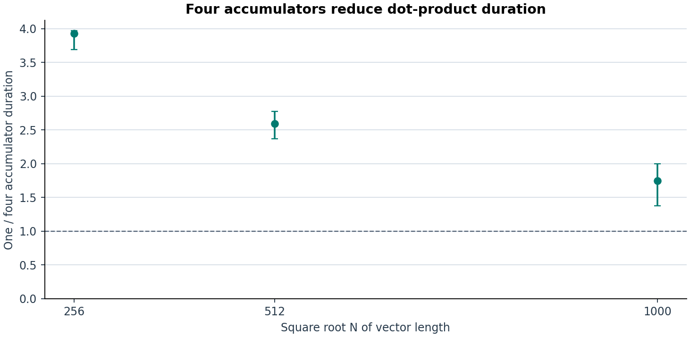
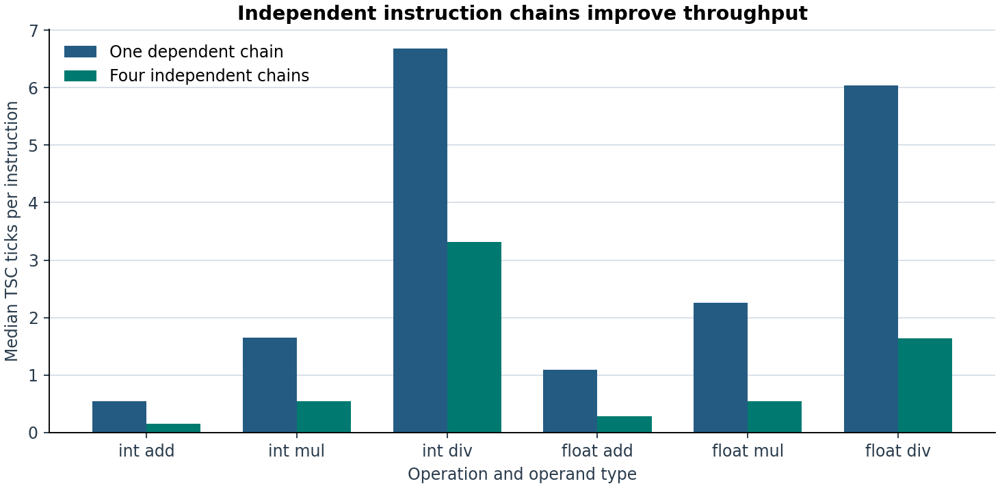

# CPU Architecture and Performance Analysis

C microbenchmarks for loop order, memory access, matrix tiling, GCC optimization,
and instruction dependencies on x86-64. The benchmarks measure elapsed time
with the Time Stamp Counter (TSC) using fenced `RDTSCP` reads.

## Reference measurements

The archived measurements used GCC 13.3.0 on a pinned performance core of an
Intel Core i5-1335U under Linux. The invariant TSC ran at 2.496 GHz. Kernel
comparisons used 30 launches per configuration. Instruction-chain measurements
used 10.

<!-- measurement-summary -->
- GCC `-O0` took **3.2–17.5×** the `-O2` duration. `-O1` was slower in 13 of 16 comparisons.
- Column-wise copy took **7.52–21.20×** the row-wise duration among pairs above the timer threshold.
- At N=1000, `ijk` took **5.695×** the `ikj` duration (95% interval 5.552–5.862). The ratio of median durations was 5.651.
- At N=1000, **8** was the smallest tested block size that met the 5% gain criterion (1.388× for unblocked/blocked duration).
- The one/four-accumulator dot-product ratios were **3.93× at N=256, 2.59× at N=512, 1.75× at N=1000**.
- Median integer-addition cost was **0.546 TSC ticks per instruction** on one dependent chain and **0.158** across four independent chains.
<!-- /measurement-summary -->

The paired figures show the median of per-round duration ratios and their
descriptive 95% bootstrap intervals. The GCC figure compares the medians of
per-launch medians. The [reference data dictionary](data/README.md) describes
the units, filters, and decision rules.

| GCC optimization | Memory traversal |
| --- | --- |
|  |  |

| Matrix multiplication | Blocking |
| --- | --- |
|  |  |

| Accumulator count | Instruction chains |
| --- | --- |
|  |  |

## Build and reproduce

Use GCC and GNU Make on Linux x86-64 with SSE2 and RDTSCP. Figure regeneration
also requires Python 3.10 or newer.

```sh
make all              # Build the benchmark executables
make test             # Run the functional checks against independent oracles
make bench            # Collect a small set of new timings on this host

python3 -m venv .venv
.venv/bin/python -m pip install -r requirements.txt
make figures PYTHON=.venv/bin/python
```

`make figures` reads the six CSV inputs in `data/`, overwrites the six
showcase PNGs in `assets/`, and writes the numerical summary to
`results/summary.md`. `make check` adds smoke runs of the timing and CPU
probes. `make run N=256 M=5` collects new samples with chosen dimensions.
See [the timing methodology](docs/METHODOLOGY.md) for affinity, timer
qualification, and interpretation.

## Limits

TSC ticks measure elapsed reference-clock time. Core frequency, temperature,
interrupts, and SMT activity can shift observed durations. The intervals
describe this set of runs. Hardware counters were unavailable during the
reference campaigns, so cache-set conflicts and stride effects are plausible
interpretations. Replotting uses the archived summaries, while a new run
measures the current machine and may produce different numbers.

## License and attribution

See the [MIT license](LICENSE) for original contributions and [NOTICE](NOTICE)
for the provenance of the inherited kernels and plotting dependency.
