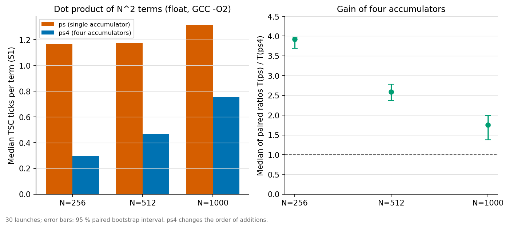

# Reference results

Reference measurements of the C programs in [`../src`](../src): GCC
optimisation levels, matrix copy order, matrix multiplication loop order,
block size, and dot-product accumulators. The CSV files are in [`csv/`](csv)
and the figures in [`figures/`](figures).

## Provenance and reproducibility

These are archived results from measurement campaigns run with a longer
protocol than the one implemented by `make run` or `make bench`: 30 launches
(rounds) per configuration, the process pinned to one performance core,
configurations in random order within each round, and temperature and
frequency sensors logged around each launch. The campaign drivers and the
statistical post-processing were separate scripts that are **not part of this
repository**, so `make` does not regenerate these tables. The repository
publishes the values as reference results together with the programs that
produced them (the kernels are the same algorithms; identifiers were renamed
for publication). The figures were rendered from the CSV files with
matplotlib; the plotting script is not distributed.

Running `make run` once on another machine gives raw samples for that machine.
Absolute values do not transfer between machines; the qualitative orderings
(for example `ikj` faster than `ijk`) are what this repository documents.

Local experimental outputs belong in `results/local/`, which is ignored by Git:

```sh
mkdir -p results/local
make run > results/local/run.csv
```

## Platform and conditions

| Item | Value |
| --- | --- |
| Processor | Intel Core i5-1335U (hybrid: performance and efficiency cores) |
| Core used | one performance core (CPUID leaf 0x1A core type `0x40`), `taskset` |
| Caches (CPUID leaf 4) | L1D 48 KiB, L2 1.25 MiB per performance core, L3 12 MiB |
| TSC | invariant, 2.496 GHz (CPUID leaf 0x15: 130/2 x 38.4 MHz) |
| Compiler | GCC 13.3.0 (Ubuntu 24.04), `-std=gnu11 -Wall -Wextra -Werror`, `-O0` to `-O3` as stated, no `-march`, no `-ffast-math`, no LTO |
| Operating system | Linux |
| Not controlled | core frequency state (sysfs readings from 0.4 to 4.6 GHz), package temperature (70 to 100 C observed, median 87 to 89 C depending on the campaign), background activity, SMT sibling activity, interrupts |

Sources of the per-dataset conditions:

| Dataset | Samples per launch | Per-launch filtering | Launches |
| --- | --- | --- | --- |
| `gcc_optimization_levels.csv` | 51, first discarded | high outliers above Q3 + 1.5 IQR removed | 30 |
| `copy_ij_vs_ji.csv` | 51, first discarded | high outliers above Q3 + 3 IQR removed (if IQR > 0) | 30 |
| `matrix_multiply_ijk_vs_ikj.csv`, `block_size_n1000.csv`, `dot_product_ps_vs_ps4.csv` | 3, first discarded, two kept | none (two samples) | 30 |

Every configuration was checked against the timer-cost criterion: the raw
duration of a measured call is at least 100 times the cost of an empty timer
pair, except the copy rows flagged `duration_at_least_100x_timer_cost = 0`
(float, N=256), which are descriptive only. The smallest ratio among the
matrix, block, and dot-product configurations is 134 (`ikj`, N=32).

## Statistics

- **Tick**: one TSC increment, not a core clock cycle. Seconds are
  `ticks / 2.496e9`. Turbo, frequency changes, and hybrid cores prevent a
  direct conversion to core cycles. See [`../docs/METHODOLOGY.md`](../docs/METHODOLOGY.md).
- **Ticks per iteration**: ticks of one call divided by `N^2` (zero, copy,
  addition, dot product) or `N^3` (matrix multiplications). The matrix
  multiplication `ikj` and blocked versions include zeroing the result.
- **S1**: median over launches of the per-launch median. **S2**: median over
  launches of the per-launch minimum (best case, sensitivity only).
- **Two different ratios are published for comparisons; they are not the same
  quantity**:
  - `ratio_of_median_durations_*` is the ratio `S1(a) / S1(b)` of two
    statistics.
  - `median_of_paired_ratios_*` is the median over the 30 rounds of the ratio
    `t_a / t_b` of the two measurements taken in the same round. It is the
    primary estimator of a paired gain. Its 95 % interval
    (`paired_ratio_ci95_low`, `paired_ratio_ci95_high`) is a percentile
    bootstrap (10 000 resamples of the 30 paired ratios, fixed seed).
  - At N=1000, `ijk / ikj` gives **5.695** (median of paired ratios) and
    **5.651** (ratio of median durations).
  - In `gcc_optimization_levels.csv`, only the ratio of `S1` values is
    available; its interval is a bootstrap over rounds resampled in pairs.
- **Decision rule against `-O2`** (`decision_vs_O2`): `faster` or `slower`
  when the 95 % interval excludes 1 and the ratio differs from 1 by more than
  5 %; `equivalent` when the interval lies within [0.95, 1.05];
  `inconclusive` otherwise. Thirteen comparisons whose decision was fragile
  (`flagged_fragile = 1` in the main run) were repeated with 60 launches; where
  the two runs disagreed the decision is `inconclusive`. The ratio and interval
  columns keep the 30-launch values. No correction for multiple comparisons
  was applied to this table; read it as exploratory.
- **Block-size gain** (`gain_over_5pct_significant`): the median of paired
  ratios exceeds 1.05 and an exact one-sided sign test against 1.05, with
  Holm correction over the 12 block sizes at 5 %, rejects (`p_holm` is the
  adjusted p-value). A result that is not significant is not evidence of
  equivalence.

The intervals are descriptive. Rounds are not shown to be independent; the
conditions above (thermal state, frequency, background load) were not
controlled, so the results are local to this machine and state. No
hardware performance counters were available, so cache or memory-system
explanations are hypotheses compatible with the data, not demonstrated causes.

## Files

| File | Rows | Content |
| --- | --- | --- |
| [`gcc_optimization_levels.csv`](csv/gcc_optimization_levels.csv) | 64 | 7 kernels, GCC `-O0` to `-O3`, float and int, two sizes each |
| [`copy_ij_vs_ji.csv`](csv/copy_ij_vs_ji.csv) | 8 | `copy_ij` vs `copy_ji`, float and double, N = 256, 512, 1024, 1536, GCC `-O2` |
| [`matrix_multiply_ijk_vs_ikj.csv`](csv/matrix_multiply_ijk_vs_ikj.csv) | 8 | `mm_ijk` vs `mm_ikj`, float, N = 32 to 1024, GCC `-O2` |
| [`block_size_n1000.csv`](csv/block_size_n1000.csv) | 12 | `mm_b_ijk` for 12 block sizes vs `mm_ijk`, N = 1000, float, GCC `-O2` |
| [`dot_product_ps_vs_ps4.csv`](csv/dot_product_ps_vs_ps4.csv) | 3 | `ps` (one accumulator) vs `ps4` (four accumulators), float, N = 256, 512, 1000, GCC `-O2` |

### Column dictionary

Common columns: `element_type` (`float`, `int`, `double`), `N` (matrix
dimension; vectors have `N^2` elements), `gcc_level`, `launches` (number of
launches, always 30), `BL` (block size).

| Column | Unit and meaning |
| --- | --- |
| `S1_ticks_per_iteration`, `S2_ticks_per_iteration` | TSC ticks per iteration (see above); S1 median of launch medians, S2 median of launch minima |
| `S1_ci95_low`, `S1_ci95_high` | 95 % interval of S1, same unit |
| `ij_S1_ticks_per_element`, `ji_S1_ticks_per_element` | ticks per matrix element, S1 |
| `ijk_S1_ticks`, `ikj_S1_ticks`, `blocked_S1_ticks`, `ps_S1_ticks`, `ps4_S1_ticks` | ticks of one complete call, S1 |
| `*_S1_ticks_per_iteration`, `*_S1_ticks_per_term` | the same, divided by `N^3` or by the number of dot-product terms `N^2` |
| `ratio_of_median_durations_*` | ratio of two S1 values (dimensionless) |
| `median_of_paired_ratios_*` | median of the per-round ratios (dimensionless, primary estimator) |
| `paired_ratio_ci95_low`, `paired_ratio_ci95_high` | 95 % bootstrap interval of the median of paired ratios |
| `ratio_ci95_low`, `ratio_ci95_high` | interval of the ratio of S1 values (GCC file only) |
| `ijk_GFLOPs`, `ikj_GFLOPs` | `2 N^3` operations divided by the TSC-based duration, in 10^9 per second (convention: one multiplication and one addition per inner iteration) |
| `decision_vs_O2` | `faster`, `slower`, `equivalent`, `inconclusive`, or `reference` (the `-O2` row) |
| `flagged_fragile` | 1 if the decision differed between statistics in the main run |
| `duration_at_least_100x_timer_cost` | 1 if the call lasts at least 100 times an empty timer pair |
| `p_holm`, `gain_over_5pct_significant` | see the block-size rule above |

## Figures

| Figure | Data |
| --- | --- |
| [`figures/gcc_optimization_levels.png`](figures/gcc_optimization_levels.png) | `gcc_optimization_levels.csv` |
| [`figures/copy_ij_vs_ji.png`](figures/copy_ij_vs_ji.png) | `copy_ij_vs_ji.csv` |
| [`figures/matrix_multiply_ijk_vs_ikj.png`](figures/matrix_multiply_ijk_vs_ikj.png) | `matrix_multiply_ijk_vs_ikj.csv` |
| [`figures/block_size_n1000.png`](figures/block_size_n1000.png) | `block_size_n1000.csv` |
| [`figures/dot_product_ps_vs_ps4.png`](figures/dot_product_ps_vs_ps4.png) | `dot_product_ps_vs_ps4.csv` |



`ps4` splits the sum into four independent accumulators, which changes the
order of the floating-point additions; its result equals the reference on the
bounded integer-valued test data and agrees within a tolerance on fractional
data.
